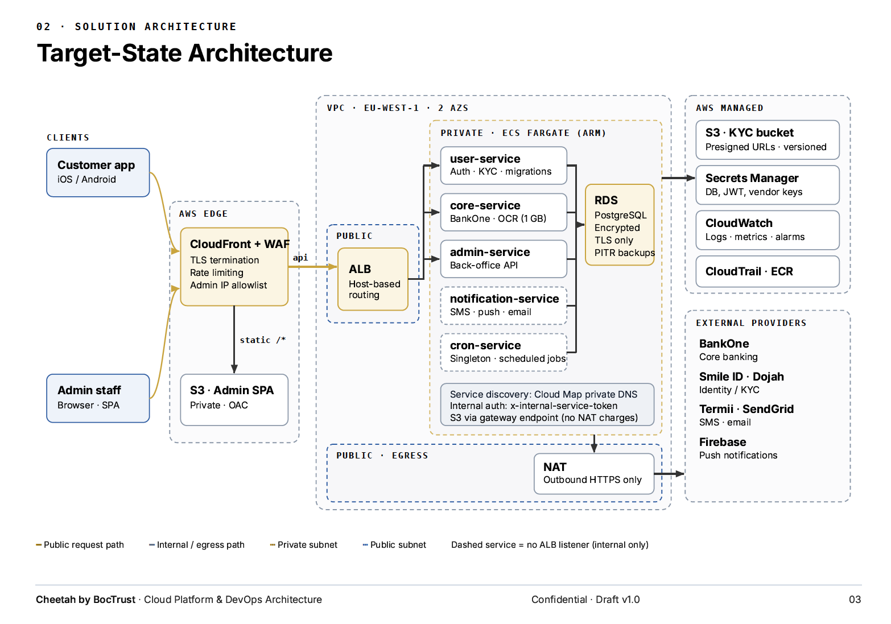
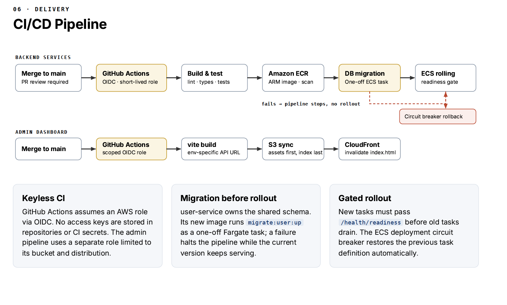
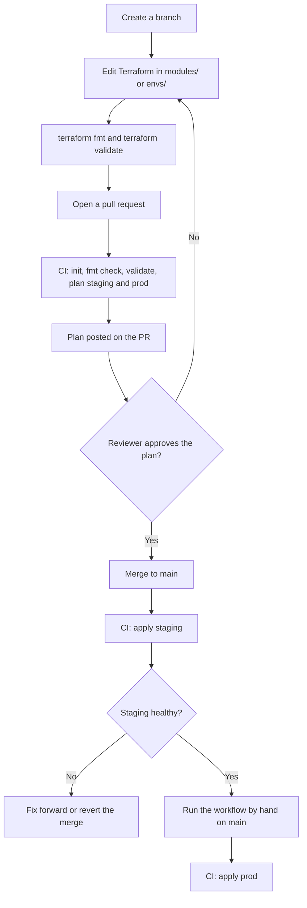

# Cheetah (BocTrust) Infrastructure

Terraform for hosting the Cheetah backend services and the admin dashboard on AWS.

- **Account:** `852922980278`
- **Region:** `eu-west-1` (Ireland)
- **Application repos:** [`boctrust-backend`](https://github.com/centurysoftware2026/boctrust-backend), [`boctrust-admin`](https://github.com/centurysoftware2026/boctrust-admin)
- **Full design document:** [docs/Cheetah-AWS-Architecture.pdf](docs/Cheetah-AWS-Architecture.pdf) (v1.0, draft for review)

> **Status:** the Terraform is written and passes `terraform validate`. It has **not been planned or applied** yet.
> Read [Cost choices](#cost-choices) and [First-time setup](#first-time-setup) before the first apply.

## Architecture



In short:

- All traffic enters through **CloudFront + WAF**. Only the **ALB** is internet-facing, and it accepts traffic from CloudFront only.
- The five Node.js services (`user`, `core`, `admin`, `notification`, `cron`) run on **ECS Fargate (ARM)** in private subnets, beside one **RDS PostgreSQL** database.
- The admin dashboard is a static site served from a private **S3** bucket through the same CloudFront.
- Secrets live in **Secrets Manager**. Containers use **IAM task roles**, not static AWS keys.
- Vendor calls (BankOne, Smile ID, Dojah, Termii, SendGrid, Firebase) leave through **NAT**.
- The ALB routes by hostname (`user-api`, `core-api`, `admin-api`), because all three APIs share the `/api/v1` prefix.

### Delivery pipeline



The application repos build and release through GitHub Actions with a short-lived OIDC role. A database
migration runs as a one-off task before any service is rolled out. This repo creates the roles, registry,
cluster and services that pipeline deploys into. The application pipelines themselves live in the app repos.

## Documentation

| Document | What it is |
|---|---|
| [docs/Cheetah-AWS-Architecture.pdf](docs/Cheetah-AWS-Architecture.pdf) | Full architecture: request lifecycle, components, security controls, CI/CD, failure modes, cost |
| [docs/images/target-state-architecture.png](docs/images/target-state-architecture.png) | Target-state architecture diagram |
| [docs/images/cicd-pipeline.png](docs/images/cicd-pipeline.png) | CI/CD pipeline diagram |

## Repository layout

```text
boctrust-infra/
├── bootstrap/            # One-time: state bucket, GitHub OIDC provider, Terraform CI roles, account baseline
├── modules/
│   ├── environment/      # Everything one environment needs. Staging and prod both call this
│   ├── network/          # VPC, 2 AZs, public/private subnets, NAT, S3 gateway endpoint
│   ├── alb/              # Application load balancer, locked to CloudFront
│   ├── edge/             # CloudFront: dashboard at /, APIs at /api/<service>/
│   ├── ecs-cluster/      # ECS cluster, Cloud Map namespace, ECR repositories, log groups
│   ├── ecs-service/      # One service: task definition, IAM roles, SG, ALB target group
│   ├── database/         # RDS PostgreSQL, subnet group, parameter group, backups
│   ├── db-init/          # One-off task that creates the per-service databases
│   ├── storage/          # KYC bucket (private, versioned, encrypted)
│   ├── admin-site/       # Admin dashboard bucket and CloudFront access
│   ├── ci-roles/         # GitHub OIDC deploy roles for the backend and admin repos
│   └── baseline/         # CloudTrail, budget alert, EBS encryption default, S3 account block
├── envs/
│   ├── staging/          # Thin root: backend, provider, settings
│   └── prod/
├── docs/
└── .github/workflows/    # Plan on pull request, apply staging on merge, apply production by hand
```

Staging and production differ only by the settings passed to `modules/environment`.

## Cost choices

The design favours the lowest running cost that is still safe for a payments backend.

| Choice | Saves | Trade-off |
|---|---|---|
| Single NAT gateway in staging | about $32 per month | An AZ outage cuts staging off from vendors |
| Graviton (ARM) Fargate, smallest size | about 20% on compute | Images must be built for `linux/arm64` |
| Fargate on-demand, not Spot | no saving | Spot could drop an in-flight transaction |
| `db.t4g.micro` in staging, Multi-AZ only in prod | about half the database cost in staging | Staging has no standby |
| No WAF yet | about $5+ per month plus requests | No managed rules until added before go-live |
| Container Insights off, 14-day logs, ECR keeps 10 images | metric and storage charges | Less built-in monitoring |
| CloudFront `PriceClass_100` | edge data transfer | Slower outside North America and Europe |
| Services start at 0 tasks | all compute until images exist | Raise `service_desired_count` after the first release |

## How requests reach the services

There is no domain yet, so everything uses the `*.cloudfront.net` name:

- `https://<id>.cloudfront.net/` is the admin dashboard.
- `https://<id>.cloudfront.net/api/<user|core|admin>/api/v1/...` is each API. CloudFront strips `/api/<service>` and tags the request, and the ALB routes on that tag.
- Requests need a secret header that CloudFront adds, and the ALB only accepts CloudFront's addresses.
- CloudFront talks to the ALB over **HTTP** until a domain and certificate exist. Move this to HTTPS with the domain.
- `notification` and `cron` are internal only. Services reach each other at `http://<service>.boctrust.internal:<port>`.

## Prerequisites

- Terraform `>= 1.10` (the state backend uses S3 native locking)
- AWS CLI v2
- Access to account `852922980278` through IAM Identity Center
- Git access to the `centurysoftware2026` GitHub organisation

## Terraform workflow

### Day-to-day change



The applied plan must be the reviewed plan. Do not apply from a laptop to production except for an
emergency, and record it in the pull request afterwards.

### First-time setup

The state bucket cannot hold the state that creates it, so setup has stages.

1. **Bootstrap** (once, by a person, with `AWS_PROFILE=boctrust`):

   ```bash
   cd bootstrap
   cp terraform.tfvars.example terraform.tfvars   # set budget_email
   terraform init
   terraform plan -out=tfplan
   terraform apply tfplan
   ```

   This creates the state bucket, the GitHub OIDC provider, the Terraform CI roles, CloudTrail and the budget alert.
   Afterwards move its state into the bucket (add a `backend "s3"` block with key `bootstrap/terraform.tfstate`, then `terraform init -migrate-state`).

2. **Staging**:

   ```bash
   cd envs/staging
   terraform init
   terraform plan -out=tfplan
   terraform apply tfplan
   ```

3. **Create the databases** (one-off). Take the values from `terraform output info`:

   ```bash
   aws ecs run-task --cluster <cluster_name> --launch-type FARGATE \
     --task-definition <db_init_task.family> \
     --network-configuration "awsvpcConfiguration={subnets=[<private_subnet_ids>],securityGroups=[<db_init_task.security_group>]}"
   ```

   It creates `user_service`, `core_service` and `admin_service` on the RDS instance if they are missing.

4. **Fill in the secrets.** Terraform creates one empty secret per service (`secret_ids` output). Put a JSON object in each,
   using the key names listed in `modules/environment/main.tf` under `secret_keys`. Every key must be present (use `""` for
   unused ones) or the task will not start. `DATABASE_URL` is built from the RDS master secret, for example
   `postgres://user:password@<endpoint>:5432/user_service`.

5. **Release the backend.** In the backend repo, create the `staging` GitHub environment and set its variable
   `AWS_DEPLOY_ROLE_ARN` to `backend_deploy_role_arn` from the `info` output. Then run the **Deploy to AWS (ECS)** workflow.
   It builds the five arm64 images, runs the user and core migrations as a one-off task, and rolls the services.
   Then raise `service_desired_count` (in `terraform.tfvars`) from 0 to 1 and apply again.
   The dashboard release uses `admin_deploy_role_arn` the same way (workflow not written yet).

6. **Production**: repeat steps 2 to 5 from `envs/prod` after staging is verified.

Production is applied by hand for now: Actions, then terraform, then Run workflow, on `main`. This is because the
`production` GitHub environment has no required reviewers yet. Once a repo admin adds them, the `apply-prod` job in
`.github/workflows/terraform.yml` can go back to running after staging, behind that approval.

GitHub setup needed once: create the `staging` and `production` environments in this repo and in the backend and admin repos, and add required reviewers to `production`. The deploy roles trust the environment name, so a job outside that environment cannot assume them.

### Local commands

```bash
terraform fmt -recursive         # format
terraform validate               # check syntax and references
terraform plan -out=tfplan       # preview, review before applying
terraform apply tfplan           # apply exactly the reviewed plan
```

## Conventions

- **State:** remote, per environment, in S3. Never commit `*.tfstate`.
- **Provider versions:** pinned, and `.terraform.lock.hcl` is committed.
- **Secrets:** never in Terraform variables, `*.tfvars` or the repo. Secret values are created in Secrets Manager
  outside Terraform or generated by the resource, and containers read them at start. Commit only `*.tfvars.example`.
- **Credentials:** no long-lived AWS keys anywhere. People use Identity Center, CI uses GitHub OIDC.
- **Naming:** resources use hyphens, and no em dashes in names or descriptions.
- **Tags:** every resource carries `Project=boctrust`, `Environment`, and `ManagedBy=terraform`.
- **Changes to the database or the IAM roles** need a second reviewer.
